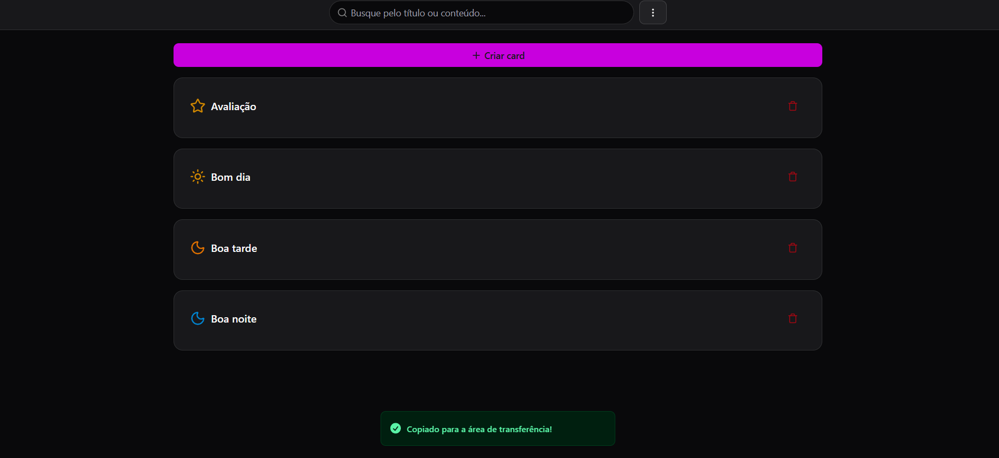

# 📇 Cards JSON

Projeto **open source** para facilitar o acesso a textos, scripts e snippets prontos para **copiar e colar** rapidamente.  
Ideal para quem quer otimizar o tempo no dia a dia de desenvolvimento ou tarefas repetitivas.

## 🔍 Visão Geral

  

## 🚀 Tecnologias Utilizadas
- [Next.js](https://nextjs.org/)
- [Shadcn UI](https://ui.shadcn.com/)
- [Tailwind CSS](https://tailwindcss.com/)
- [Zustand](https://zustand-demo.pmnd.rs/)

## 📜 Licença
Este projeto é open source e está sob a licença [MIT](LICENSE).
